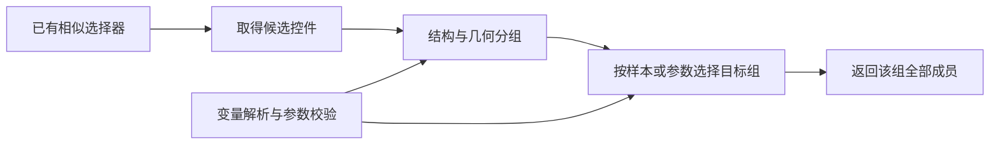

# Win32 相似元素分组：需求与期望方案

日期：2026-10-10。本文整理已讨论的需求与产品改进建议，分组配置属于拟新增能力，尚未实现。本次只编写测试侧文档。

## 1. 要解决的问题

多个业务选项组可能共用同一个 Pane，控件类型、类名和祖先路径相同。现有相似捕获保留两个样本的共同条件后，会把这些组混在一起。

旧版 Win32 靶场中，城市五项、兴趣四项、用户协议一项均为同一 Pane 下的 CheckBox。选取两个城市样本后，相似捕获与持久资产校验均返回 10 项，无法表达只包含五个城市的业务范围。

测试目录中的后续报告记录了另一种情况：靶场增加独立的城市 Pane 后，现有相似捕获已准确返回五项。该结果说明真实分组容器有效，但本需求还要覆盖应用没有提供独立分组容器的情况，不能要求用户修改被自动化应用。

## 2. 核心需求

用户提供同一目标组中的两个实际样本，系统应在现有相似候选基础上识别目标组，并保存可复用的集合定位规则。

- 分组不依赖选项名称、标签文字、业务词义、文字白名单或文字正则。
- 只使用原生观察数据：控件类型、技术属性、父子与兄弟关系、节点顺序、包围矩形等；不使用截图或视觉模型判断分组。
- 支持同一 Pane 下存在多个同类选项组，以及横排、竖排和多行布局。
- 从分组规则产生结果数量，不通过取前五项、截断集合或固定数量推断业务范围。
- 采集入库、App 校验、CLI 校验和 SDK 查找必须使用一致的分组规则。
- 分组方式和目标组可以参数化，以复用同一套规则处理不同窗口和控件组。
- 无法唯一判断时明确报告不确定，提供候选组供用户确认，不能静默返回整个 Pane 的同类控件。

“不依赖文字”针对业务分组依据。ControlType、ClassName 等技术字段即使以字符串表示，仍可作为结构特征。两个样本的 Name 不应作为组成员筛选条件。

## 3. 当前能力与缺口

本例保存的是 wnd 选择器，其条件执行支持等于匹配。当前 Package 变量是字符串，主要用于替换允许绑定的字符串条件值；替换后仍沿用原运算符。

因此，变量值 `"1,2,3"` 不会自动变成三个候选值，变量值 `"1-5"` 不会自动变成索引范围。当前元素串也没有可直接使用的逻辑组号属性。

需要新增的是分组与范围执行能力，以及相关参数的变量绑定。仅增加变量或修改已有字段值，不能解决集合混组问题。

## 4. 推荐方案：候选匹配后增加分组阶段

### 4.1 结构优先

优先使用被自动化应用提供的真实分组容器。共同祖先过大时，进一步分析候选在父容器下的兄弟序列，识别连续同类控件段和结构边界。

旧版靶场的三个 CheckBox 段分别包含 5、4、1 个成员；两个城市样本同时位于五项段内。此判断不需要读取任何标签或选项文字。

兄弟节点分段是一种分组依据，不应把任意 Text 节点都当成所有界面通用的绝对业务边界。插入辅助节点、存在中间容器或树结构不完整时，应结合其他依据判断。

### 4.2 几何校验与补充

使用观察接口返回的矩形，分析相对位置、对齐方向、组内间距与组间间隔。距离阈值相对于控件尺寸计算，位置相对于父容器计算。

旧版靶场的三个水平带同样包含 5、4、1 个成员，与结构分段一致，可以加强该次判断。

几何规则不能限定为“所有成员必须同一行”。多行布局需要结合结构和空间连续性判断；无法区分换行与另一组选项时应报告不确定。保存规则时不固化本次屏幕绝对坐标。

### 4.3 样本确定默认目标组

默认选择同时包含两个样本、且范围可唯一确定的组。样本落入不同组、存在多种合理划分，或结构与几何依据冲突且无法消解时，返回范围不确定，不提交一个范围已确认的集合资产。

候选顺序应来自明确的结构顺序或几何排序规则，不能依赖校验矩形的偶然返回顺序。

## 5. 变量设计与“等于”的关系

变量负责提供参数，分组算法负责生成组及其成员。系统计算出逻辑组号后，通过“组号等于目标参数”即可选择整组，不要求第一阶段增加大于、小于、范围或正则运算符。

以下为拟议配置，不是当前 CLI 已支持的字段或命令：

| 参数 | 建议默认值 | 期望语义 |
| --- | --- | --- |
| `group_strategy` | `"auto"` | 自动结合结构与几何；也允许明确选择 `"sibling_run"` 或 `"spatial_cluster"` |
| `target_group` | `"sample"` | 默认定位采集样本所在组；显式传入 `"1"`、`"2"` 等时，选择父范围内排序后的第 N 组，序号从 1 开始 |
| `expected_count` | 不设置 | 可选的结果数量校验；例如 `"5"` 只用于验收，不参与截断或生成分组 |

例如，分组得到 5、4、1 三组，明确设置 `target_group="1"` 时返回第一组五项，设置 `target_group="2"` 时返回第二组四项。

可以复用现有字符串变量的默认值及运行时覆盖机制，但新增分组字段必须显式支持变量绑定。枚举值、组序号和数量参数须做类型及取值校验；不执行变量里的代码或任意表达式。

逻辑组号属于系统计算的范围信息，不是原生 UIA 已存在的属性，不能直接把它填入当前元素串并期望生效。未支持的分组参数应明确报错，不能被忽略后继续返回宽泛候选。

## 6. 入库与重新定位

保存已有候选选择器、分组规则，以及重新识别采集范围所需的非文字结构锚点。临时观察 ref、HWND、固定兄弟下标和本次矩形不能作为持久范围的唯一依据。

每次查找都应重新解析父范围、取得候选、计算分组，然后返回当前成员。

`target_group="sample"` 模式应尝试通过结构锚点恢复原采集组。无法恢复或不能唯一确认时报告范围变化，不能偷偷选择相同序号的另一组。

显式序号模式表示“当前排序中的第 N 组”。新增或重排分组可能改变其业务含义，界面和文档应明确说明；默认重新定位不应只依赖序号。

建议在统一的原生定位执行路径中实现分组，Runtime 负责变量解析与参数校验，App、CLI、SDK 复用执行结果。不能只过滤 App 预览或 CLI 展示列表，而让 SDK 仍拿到全部候选。

新增分组配置应显式启用；既有未设置分组范围的资产保持现有行为。

## 7. 结果反馈与失败处理

采集及校验应区分“基础选择器可找到元素”和“目标组范围已确认”，并提供候选数、分组数、目标组成员数、采用的分组依据及失败原因。

至少应识别参数非法、组不存在、分组不确定、原采集范围无法恢复、数量校验不符等情况。失败时不静默扩大范围，不对不确定集合执行批量操作。

App 应允许查看候选分组并确认范围；CLI 和 SDK 应得到可处理的失败结果与诊断数据。截图预览可以用于人工反馈，但自动分组过程不依赖视觉模型。

## 8. 验收标准

| 场景 | 期望结果 |
| --- | --- |
| 同一 Pane 下有 5、4、1 三组选项，两个样本来自五项组 | 仅返回五项；四项组与单项组均被排除 |
| 改变全部业务标签与选项文字，结构和位置不变 | 分组范围不变 |
| 应用提供独立分组 Pane | 使用该真实范围，准确返回目标组 |
| 窗口移动、缩放或 DPI 改变 | 基于当前结构与相对矩形重新判断，不使用旧绝对坐标 |
| 竖排或多行布局 | 正确识别目标组；信息不足时明确不确定，不扩大范围 |
| 插入辅助节点或新的选项组 | 可恢复原样本范围则保持原组；无法恢复则报告范围变化 |
| 两个样本属于不同组，或存在无法消解的分组歧义 | 明确拒绝确认范围，不静默保存整个候选集合 |
| 变量选择不同组 | 返回所指定组的完整成员；非法参数和越界序号报错 |
| 设置 `expected_count="5"`，实际目标组数量变化 | 数量校验失败，不截断凑足五项 |
| 保存后关闭观察，再通过持久资产查找 | App、CLI、SDK 返回一致范围，不依赖原观察 ref |
| 既有资产未启用分组配置 | 原有定位行为不变 |

五项只是该靶场的验收预期，算法本身不硬编码数量。测试可以利用已知控件身份核对范围，但这些业务身份不能成为通用分组算法的输入名单。

## 9. 第一阶段范围

优先交付同一父容器下的真实容器识别、连续兄弟节点分组、相对几何校验、分组参数变量绑定，以及入库后的统一执行和诊断。

通用范围运算符、列表变量展开、多次等于查询合并等属于另一项表达能力扩展，不是本需求第一阶段的必需条件。自动推断无法覆盖所有缺少区分信息的界面，需保留人工确认范围的入口。

## 10. 证据与历史核对版本

以下记录来自已有测试证据，本次整理未重新运行 CLI，也未改写库资产。

- [旧版同 Pane 混组报告](D:/code/元素库/CLI测试/Example/2_win32表单填写/evidence/20261010_110504_入库/report.md)：相似捕获与校验均为 10 项。
- [旧版范围逐项核对](D:/code/元素库/CLI测试/Example/2_win32表单填写/evidence/20261010_110504_入库/similar-scope-check.json)：目标五项、额外五项。
- [独立 Pane 修改后的重采集报告](D:/code/元素库/CLI测试/Example/2_win32表单填写/evidence/20261010_163103_靶场修改后重采集/report.md)：现有相似捕获已准确返回五项；该结果不等同于通用分组能力已实现。

源码核对版本：

- 元素抓取器：`D:\code\rust_uia`，commit `b700f9238134f57da83ab478a5ee55337ade1082`。
- Desktop：`D:\code\desktop`，commit `7f148f27c0efa8bbba1f18d86c14845ea7d639fa`。
- SDK 来源：`D:\code\desktop\sdk`；SDK 测试目录：`D:\code\元素库\sdk测试`。
- CLI 测试目录：`D:\code\元素库\CLI测试\Example\2_win32表单填写`。
- CLI：`D:\code\desktop\cli\target\x86_64-pc-windows-msvc\release\uia.exe`；版本 `uia 0.1.1`，历史 `--version` 退出码 0。
- CLI SHA-256：`C4CC52C93DAC523F354C8BAE6B08DA412E6B16E5FA8D2B14917B233A624FCCB8`。commit 和版本号不能单独证明二进制构建来源。

关键源码位置：

- [相似条件泛化](D:/code/rust_uia/src/element_library_store.rs:2474)：保留样本共有条件，区别性条件转为未启用。
- [wnd 等于条件读取](D:/code/rust_uia/src/wnd_selector.rs:730)：当前本例的运算符限制。
- [Win 变量替换](D:/code/desktop/runtime/services/package_variables.py:345)：当前字符串条件绑定机制。
- [App 变量字段限制](D:/code/desktop/app/src/winElementPathModel.ts:125)：当前非根层已启用字符串字段的绑定入口。

产品实现应由对应产品项目处理；测试工作区负责需求材料、复现证据和后续行为验收。
